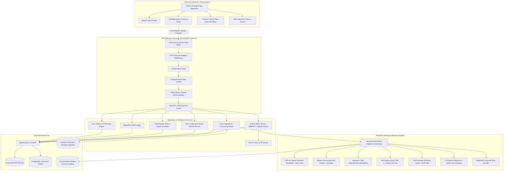
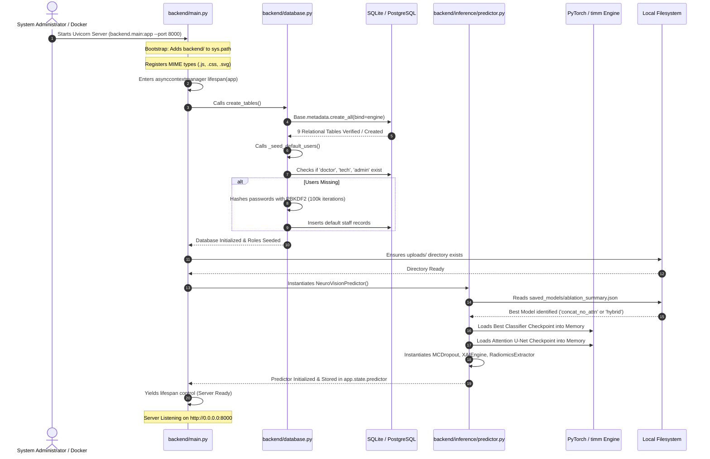
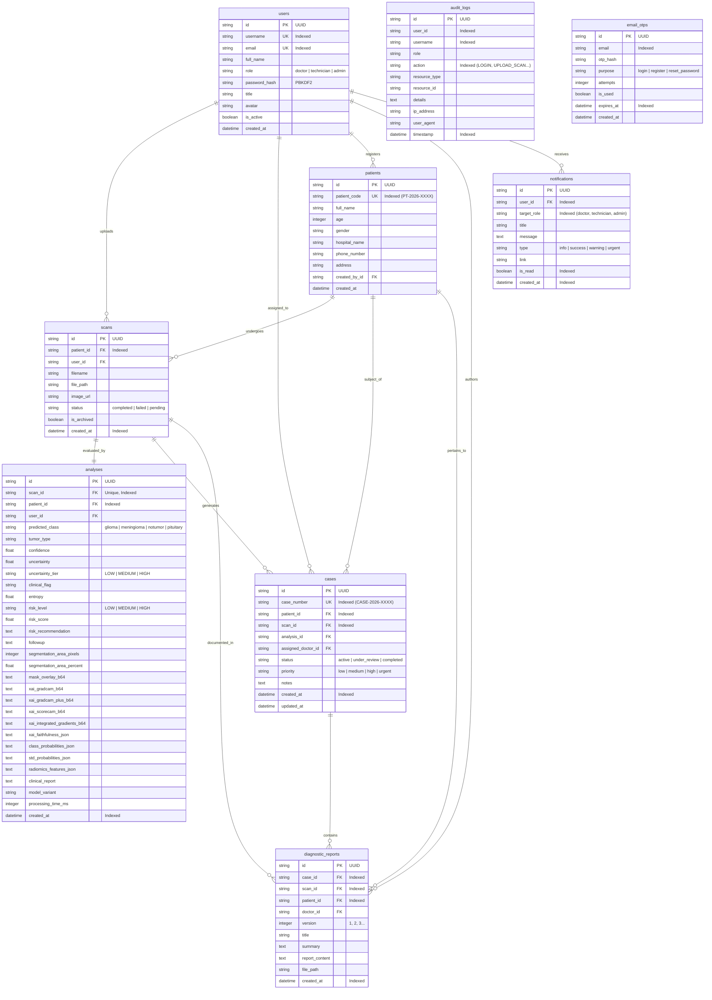

# NeuroVision (NeuroScan AI) — Architecture & Data Flow Guide

> **System Blueprint & Execution Trace**  
> This document details the exact runtime architecture, component communication patterns, lifecycle sequences, error-handling strategies, and database entity relationships of NeuroVision.

---

## 1. High-Level System Architecture

The NeuroVision architecture follows a decoupled, three-tier clinical web architecture:



---

## 2. Application Startup & Bootstrap Flow

The sequence diagram below traces what happens from server launch (`python -m uvicorn backend.main:app`) until the server is fully ready to accept client connections:



---

## 3. End-to-End Clinical Workflows

### Workflow 1: MRI Ingestion, Inference & Case Creation
- **File Paths Involved:**
  - `frontend/src/pages/upload.tsx`: `UploadPage` wizard capturing MRI file and patient details.
  - `backend/main.py`: Gateway router forwarding request to scans router.
  - `backend/api/routes_scans.py`: `validate_image_security()`, `upload_and_analyze_scan()`.
  - `backend/inference/predictor.py`: `NeuroVisionPredictor.predict()`.
  - `backend/inference/uncertainty.py`: `MCDropoutPredictor.predict_with_uncertainty()`.
  - `backend/models/attention_unet.py`: `AttentionUNet.forward()`.
  - `backend/xai/xai_engine.py`: `XAIEngine.generate_all()`.
  - `backend/radiomics/radiomics_extractor.py`: `RadiomicsExtractor.extract()`.
  - `backend/inference/risk_stratifier.py`: `compute_risk_score()`.
  - `backend/report/report_generator.py`: `generate_clinical_report()`.
  - `backend/database.py`: Entities `Patient`, `Scan`, `Analysis`, `Case`, `DiagnosticReport`, `AuditLog`.
  - `backend/auth.py`: `log_audit_event()`.

- **Step-by-Step Execution Trace:**
  1. **Upload Initiation:** In `frontend/src/pages/upload.tsx`, a doctor or technician selects an MRI image (`.jpg` or `.png`) and enters optional patient demographics (Full Name, Age, Gender, Hospital).
  2. **Multipart Request:** The browser dispatches a `POST /api/scans/upload` request containing the binary image and form fields.
  3. **Perimeter Validation (`routes_scans.py:31-65`):** `validate_image_security()` checks that `len(contents) <= 25MB`, the extension is whitelisted, and initial magic bytes match standard formats (`\xff\xd8\xff` for JPEG, `\x89PNG` for PNG).
  4. **Image Parse & Storage (`routes_scans.py:177-196`):** The image is parsed via PIL into RGB. A unique UUID filename is generated (`scan_XXXX_TIMESTAMP.jpg`) and written to the `uploads/` directory on disk.
  5. **Patient Resolution (`routes_scans.py:198-232`):** The database is queried for an existing `Patient` matching `patientId`. If not found, a new `Patient` record is inserted with a collision-proof code (`PT-2026-XXXX`).
  6. **Scan Entity Insertion (`routes_scans.py:234-245`):** A `Scan` record is created in the database with status `completed` and linked to `patient.id`.
  7. **ML Pipeline Execution (`predictor.py:139-207`):**
     - **Uncertainty Pass:** `MCDropoutPredictor` executes 50 stochastic forward passes with active dropout, calculating mean class probabilities, standard deviation ($\sigma$), and Shannon entropy.
     - **XAI Heatmaps:** `XAIEngine` generates Grad-CAM, Grad-CAM++, Score-CAM, and Integrated Gradients overlays.
     - **Attention U-Net Segmentation:** `AttentionUNet` generates a binary mask and calculates tumor area in pixels and slice percentage volume.
     - **Radiomics Extraction:** `RadiomicsExtractor` computes 13 intensity, GLCM texture, and shape descriptors with SHAP rankings.
     - **Risk Stratification:** `compute_risk_score()` computes the weighted composite clinical score (`LOW`, `MEDIUM`, `HIGH`).
     - **Faithfulness Verification:** `XAIEvaluator` runs the Pointing Game and Pixel Flipping energy-decay curves.
     - **Clinical Narrative:** `generate_clinical_report()` compiles the full radiology report.
  8. **Multi-Table Relational Persistence (`routes_scans.py:261-330`):**
     - Inserts `Analysis` record holding all serialized metrics and base64 overlays.
     - Inserts `Case` record with auto-generated case number (`CASE-2026-XXXX`) and triage priority (`urgent` if high risk).
     - Inserts `DiagnosticReport` v1 containing the clinical narrative.
  9. **Notification & Audit (`routes_scans.py:332-370`):**
     - Dispatches in-app `Notification` targeted to the `doctor` role.
     - Invokes `log_audit_event(action="UPLOAD_AND_ANALYZE_SCAN")` recording user, scan ID, IP address, and diagnosis.
  10. **Client Response:** The endpoint returns the comprehensive scan detail JSON payload (HTTP 200). The frontend automatically transitions the view to `/scan/:id`.

---

### Workflow 2: Clinical Case Management & Status Updates
- **File Paths Involved:**
  - `frontend/src/pages/cases.tsx`: `CasesPage` clinical review board view.
  - `backend/api/routes_cases.py`: `list_cases()`, `update_case()`.
  - `backend/auth.py`: `get_current_user()`, `log_audit_event()`.
  - `backend/database.py`: Entity `Case`.

- **Step-by-Step Execution Trace:**
  1. **Case Listing:** The physician opens `/cases`. TanStack Query fetches `GET /api/cases`.
  2. **Database Query:** `list_cases()` queries the `cases` table joined with `patients`, `scans`, and `analyses`, ordered by `created_at DESC`.
  3. **Review & Triage:** The doctor selects a case, modifies the status from `active` to `under_review`, changes priority to `high`, and enters clinical review notes ("Focal mass requires contrast correlation").
  4. **PUT Request:** The client dispatches `PUT /api/cases/{id}` with JSON body `CaseUpdateRequest`.
  5. **Authentication & Mutation (`routes_cases.py:88-121`):** `get_current_user` validates the session token. `update_case()` updates the record, commits the database transaction, and refreshes the entity.
  6. **Audit Event:** `log_audit_event(action="UPDATE_CASE")` logs the modification in `audit_logs`.
  7. **UI Cache Invalidation:** On success, `queryClient.invalidateQueries(["/api/cases"])` triggers a background refetch, updating status badges across the UI.

---

### Workflow 3: Diagnostic Report Generation & Download
- **File Paths Involved:**
  - `frontend/src/pages/scan-analysis.tsx`: `generateReportMutation`.
  - `backend/api/routes_reports.py`: `generate_report_for_scan()`, `download_report()`.
  - `backend/report/report_generator.py`: `generate_clinical_report()`.
  - `backend/database.py`: Entity `DiagnosticReport`.

- **Step-by-Step Execution Trace:**
  1. **Trigger:** On `/scan/:id`, the physician clicks "Generate Clinical Report".
  2. **API Request:** Dispatches `POST /api/scans/{id}/reports/generate`.
  3. **Version Increment (`routes_reports.py:88-93`):** The server queries existing report counts for the scan. If version 1 exists, increments to `version = 2`.
  4. **Text Compilation (`routes_reports.py:95-125`):** Extracts analysis fields from the database and invokes `generate_clinical_report()`.
  5. **Persistence:** Commits new `DiagnosticReport` record linked to `scan.id` and `case.id`. Logs `GENERATE_REPORT`.
  6. **Download:** When the physician clicks "Download Report", the client requests `GET /api/reports/{id}/download`.
  7. **Attachment Stream (`routes_reports.py:144-170`):** The server logs `DOWNLOAD_REPORT` and streams `PlainTextResponse` with `Content-Disposition: attachment; filename="neuroscan_report_XXXX.txt"`.

---

## 4. Database Entity-Relationship Diagram (ERD)

The relational schema comprises 9 tables enforcing strict foreign key integrity, cascade delete constraints, and indexes on frequent lookup keys:



---

## 5. Authentication & Authorization Sequence Flow

The diagram below details the end-to-end security handshake for authentication, signed token issuance, cookie setting, and subsequent RBAC verification:

```mermaid
sequenceDiagram
    autonumber
    actor User as Hospital Staff (Doctor)
    participant Client as React Client (Login View)
    participant API as FastAPI Gateway (/api/auth/login)
    participant Auth as backend/auth.py
    participant DB as SQLite / PostgreSQL
    participant Audit as Audit Logger

    User->>Client: Enters Username & Password
    Client->>API: POST /api/auth/login {"username": "doctor", "password": "..."}
    
    API->>Auth: check_rate_limit(client_ip, max=5, window=300s)
    alt Rate Limit Exceeded
        Auth-->>API: Rate Limit Failed
        API-->>Client: HTTP 429 Too Many Requests
    end
    
    API->>DB: Query User by username or email
    DB-->>API: Returns User Record
    
    API->>Auth: verify_password(plain_password, user.password_hash)
    Note over Auth: Extracts salt & key<br/>Computes PBKDF2-HMAC-SHA256 (100k iters)<br/>hmac.compare_digest(key, expected)
    
    alt Password Invalid
        Auth-->>API: Verification False
        API->>Audit: log_audit_event("LOGIN_FAILED")
        API-->>Client: HTTP 401 Unauthorized ("Invalid credentials")
    end
    
    API->>Auth: create_token(user.id, user.username, user.role)
    Note over Auth: Payload: {sub, username, role, iat, exp}<br/>Signature: HMAC-SHA256(payload_b64, AUTH_SECRET)<br/>Token: payload_b64.signature
    
    API->>Audit: log_audit_event("LOGIN_SUCCESS")
    API-->>Client: HTTP 200 OK + User JSON<br/>Set-Cookie: auth_token=...; HttpOnly; SameSite=Lax
    
    Note over Client: User Navigates to Admin Section (/api/users)
    Client->>API: GET /api/users (Cookie: auth_token=...)
    API->>Auth: get_current_user() Dependency
    Auth->>Auth: decode_token(auth_token)
    Note over Auth: Validates HMAC-SHA256 signature<br/>Checks expiration timestamp (exp > now)
    Auth->>DB: Query User by payload['sub']
    DB-->>Auth: User Record (role: "doctor")
    
    API->>Auth: require_role(["admin"]) Dependency Factory
    Note over Auth: Checks: user.role in ["admin"]
    alt Role Mismatch (doctor != admin)
        Auth-->>API: Raises HTTPException(403)
        API-->>Client: HTTP 403 Forbidden ("Access forbidden: User role 'doctor' lacks permission")
    end
```

---

## 6. Failure Modes & Error Recovery Matrix

| Failure Mode | Root Cause | System Behavior & Handling | Recovery / Remediation |
| :--- | :--- | :--- | :--- |
| **Model Weights Missing** | `saved_models/*.pth` files deleted or unmounted. | `NeuroVisionPredictor.__init__()` detects missing checkpoint, prints explicit terminal warning, and falls back to randomly initialized weights. Health check reports `"ml_inference": {"status": "not_loaded"}`. | Run `run_pipeline.py` or restore checkpoints to `/saved_models`. |
| **Corrupted Image Upload** | Client uploads non-image binary, truncated file, or polyglot payload. | `validate_image_security()` checks initial bytes against magic signatures. Rejects with clean HTTP 400 JSON: `"File integrity check failed: file header does not match a valid medical image format."` | Client must provide a valid JPEG, PNG, or TIFF image. |
| **Database Disconnection** | SQLite lock contention or PostgreSQL database container crash. | `health_check()` catches exception, returning `"database": {"status": "unhealthy: OperationalError"}` and overall status `"degraded"`. FastAPI returns HTTP 500 JSON. | Docker Compose automatically restarts PostgreSQL (`restart: unless-stopped`). |
| **SMTP Server Downtime** | External mail server (e.g., `smtp.gmail.com`) unreachable or credentials invalid. | `email_service.py:101-103` catches `Exception`, logs terminal warning: `"[EmailService] Failed to send email via SMTP"`, and returns `False`. Fallback mock dispatch prints OTP to console. | Verify `.env` SMTP credentials; application does not crash. |
| **Out-of-Memory (OOM) on Forward Pass** | GPU VRAM exhausted by concurrent high-resolution inputs. | `predictor.predict()` raises exception; caught by `routes_scans.py:251-255`. Updates scan status to `failed`, commits to DB, and returns HTTP 500 JSON. | Restart worker or configure PyTorch CPU fallback via `device = torch.device("cpu")`. |
| **Concurrent Duplicate Patient Registration** | Multiple clients simultaneously register the same patient code. | Database column `patient_code` has a `unique=True` constraint. `routes_patients.py:80-84` executes an atomic while-loop check generating sequential unique identifiers (`PT-2026-XXXX`). | Handled transparently by auto-incrementing collision-avoidance logic. |
